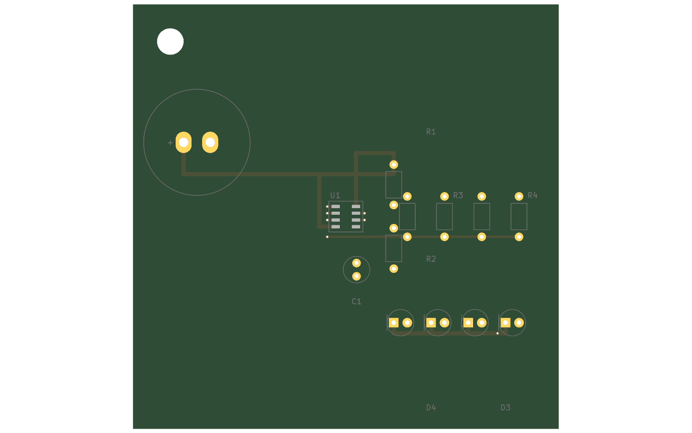
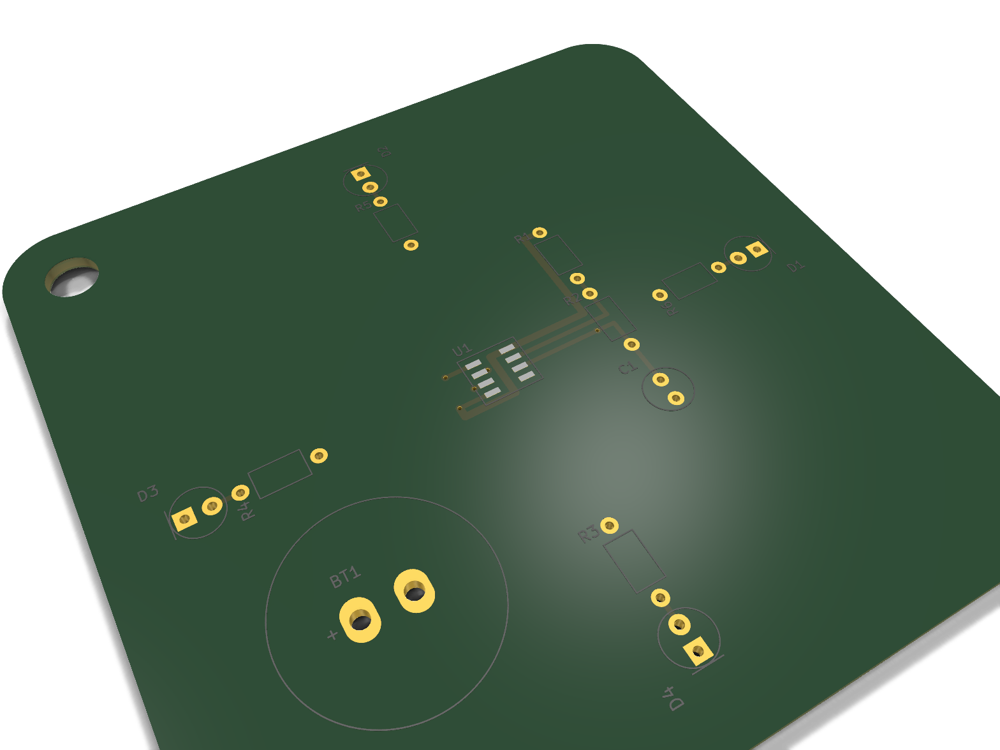
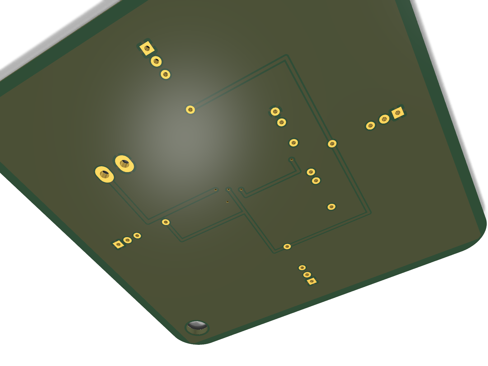
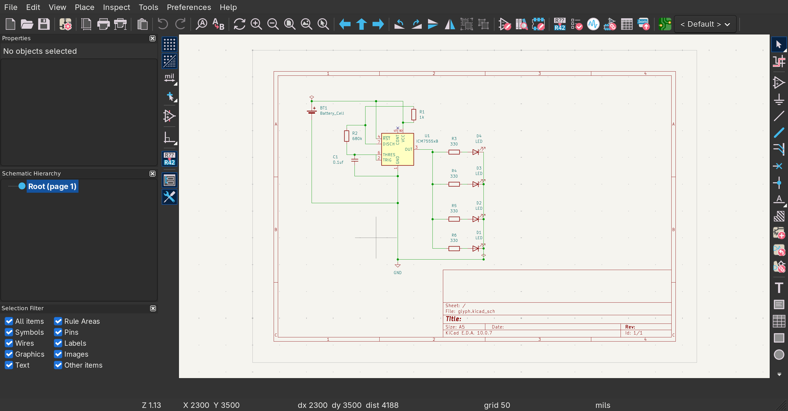
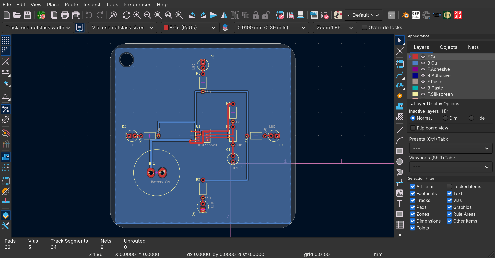
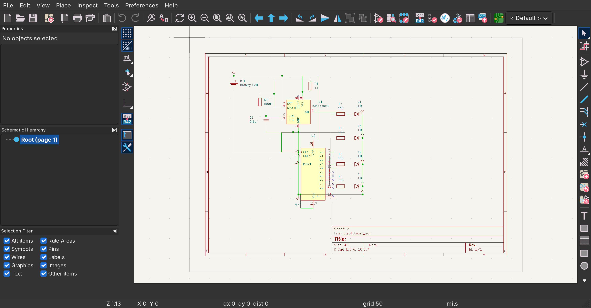
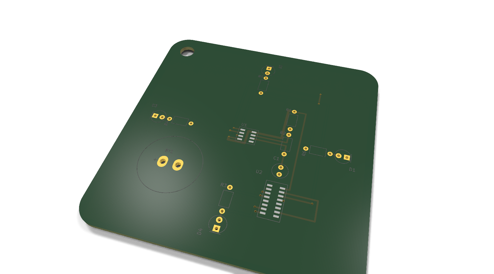
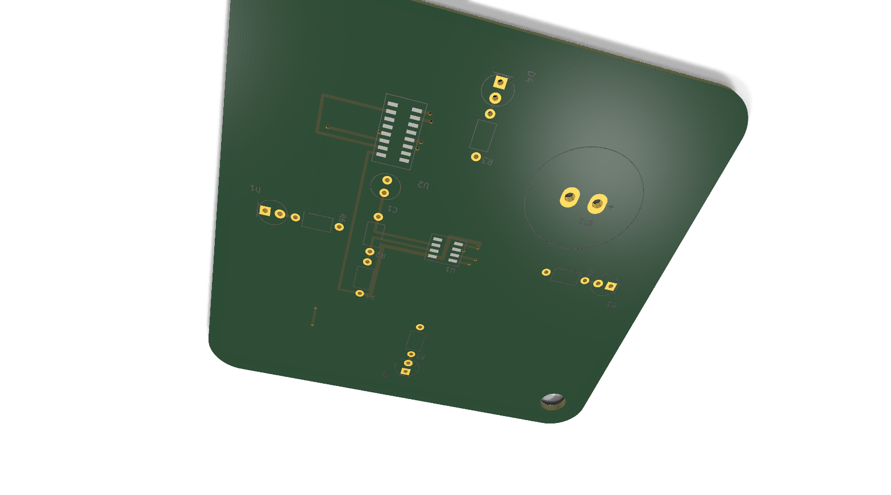

### Total time spent: 16 Hours

## Day 1 - Getting started! - October 16th - 6 Hours

techwear is booming and its pretty damn expensive so i decided to make my own open source version!

the idea is still pretty vague, ive basically just got a square in my head with a 555 timer and a bunch of LEDs. might change later

---

---

i got most of the components figured out now, never actually worked with a 555 timer before even tho its one of the most common ICs out there but no worries

spent quite a while just iterating on the idea and figuring out the wiring, kept going back and forth on a few things but i think its coming together pretty well

---

---

okay so its been a while

turns out i forgot about cathode and anode which uh caused quite some problem but nws i got it figured

---

---

finally got it all wired up and had 2 other hardware nerds verify it too, so this part is pretty much done

took way longer than i expected for something this simple but atleast its working out now

slow and steady i guess

---

with the schematic sorted i moved onto the board. first attempt i just kinda yeeted everything onto a square and wired it up. it worked but it looked SO bad... im gonna uh make it better

---

---

nobody wanna wear that crap so i had to redo that

redid the whole thing corner and things and yeah ofcourse now the leds arent on just one side ive distributed them

i also added ground pour for gnd ive no idea why i do that butokay thats what all the nerds tell me to moving ahead the wiring is pretty easy

---

---

not the very proud of schema its a mess rn

=the timing cap is wired between two pins

i figured something out in the datasheet which i dont remember but it was something about having one pin of the cap at ground

---

---

then pushed the fixed schematic back into the pcb and fixed the drc

heres the kicad image

---

---

so pretty much day one done.. im tired

pretty happy with it for a first day

## Day 2 - It chases now! - October 17th - 4 Hours

got bored of all four leds blinking in sync so im going to add chase to it

apparently ive to include a second ic which uh means more wiring sob

the 4017 has 10 outputs but i only need 4 its all chill

here is the updated schematic

---

---

two little traps on the way there:

there is a clock enable pin, which i often forget to wire

then onto the board, which was pretty easy and got done in 2 hours with the routing

0 drc issue, :P

---

---

here it is in kicad

---

---

so day two done. the keychain now chases instead of blinking

from blinky to chaser extremely happy with how this turned out

## Day 3 - Silkscreen! - October 16th - 2 Hours

im quite tired today....probably not gonna much but heres so far

i got done with the silkscreen, took me a while to figure out howd you import it to kicad used some online tool to convert it to some text which i pasted it? not sure if its the best way but idk how else you do it

okay wait i almost forgot about the back part, i had to again redo it heres the look

very cool i'd say, nevertheless im eepy and going to sleep like a baby

## Day 3 - October 16th (nightime) - 2 Hours

okay so uh i woke up at 12am.. going to some more work-

for starters i redid the routing because some traces werent properly connected to ground plane and i also fixed the footprint symbol of the LEDs because they were apparently the big one i needed the small one which have higher forward voltage and can work with 3v ewkuhhroir i am going to crash out

very cool image to understand what forward voltage is... sure was a pain in ass but its okay i figured it out and now my pcb is fine.. i did some maths too but i dont got the copy on me so i rather not count that time

## Day 4 - SUBMITTING DA PROJECT - October 17th - 1 Hours

i was cleaning up the schema to submit it but holyshit i cant get rid of whatever these are so im gonna let them be since the dont do anything and i manually connected them to ground pore in pcb.. they are a bit messed here i tried my best but whatever yes

i also did cleaning up, made bom & github finalized everyhting and yeah thats it
